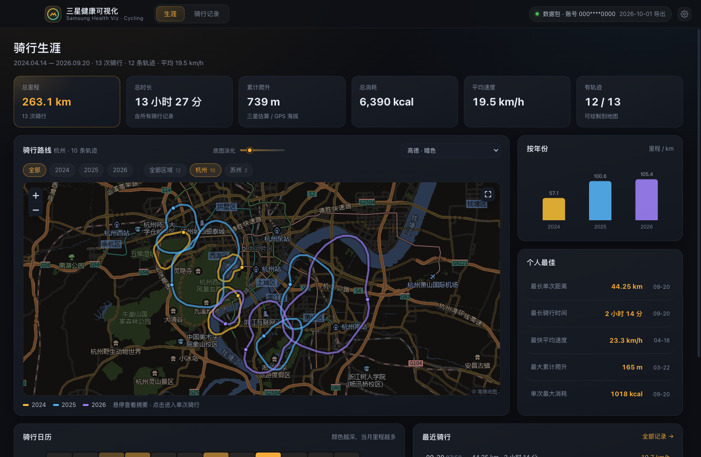

# 骑行生涯 · Samsung Health 可视化

把三星健康（Samsung Health）导出的数据包变成本地骑行生涯地图：**首期只做骑行**（`exercise_type = 11007`），
支持选择自己的数据包解析、全部骑行路线叠在地图上、单次骑行详情（轨迹按速度着色、速度/心率/海拔/恢复心率曲线、分段配速）。



## 技术栈

| 层 | 选型 |
|---|---|
| 桌面壳 | Electron 45（主进程 ESM） |
| 渲染 | Vue 3（SFC + `<script setup>`）+ vue-router（hash 模式） |
| 构建 | Vite 8 + `@vitejs/plugin-vue` |
| 图表 | ECharts 6 + vue-echarts（折线、柱状、日历热力） |
| 地图 | Leaflet 1.9（高德暗色/标准/卫星、Esri 卫星、OSM、离线无底图；轨迹描边 + 底图淡化） |
| 数据 | `adm-zip` 直接读取用户选择的 ZIP；CSV 自行解析（三星导出格式：两行文件头 + 行尾空字段） |

## 运行

环境：Node ≥ 20（全局 Node 即可）、pnpm。

```bash
cd samsung-health-viz
pnpm install
pnpm dev            # 开发：Vite dev server + Electron（改渲染代码热更新）
pnpm build          # 构建渲染层
pnpm start          # 以构建产物启动 Electron
```

## 地图主题与轨迹可读性

生涯页/详情页右上角可切换底图，并在「底图淡化」滑杆调节底图强度（轨迹会带深色描边，任何底图下都能看清）：

- **高德 · 暗色（默认）**：压暗后的高德矢量图 + 中文地名，彩色轨迹最醒目；
- 高德 · 标准 / 高德 · 卫星（中文标注）/ Esri 卫星；
- OpenStreetMap（WGS-84 参考底图，可用来核对轨迹是否贴合道路）；
- 无底图（离线，纯轨迹 + 深色网格）。

> 坐标说明（混合坐标系，按数据本身的来源自动判定）：
> - 三星健康导出里**没有**显式的“坐标基准”字段，但轨迹 JSON 会暴露来源格式：
>   **手机 App 写入的轨迹点带 `version` 字段**（对应的 `location_data_internal` 还有 `source_type`），
>   **手表记录的轨迹点没有**；
> - 手机（Galaxy/OnePlus 都一样）的定位由系统定位服务/地图 SDK 给出 → **GCJ-02**；
>   手表的 GNSS 原始定位 → **WGS-84**（这也是为什么手机上的三星健康显示正常：它在渲染时按来源换算）；
> - 解析时按「点格式（version）→ 设备类型（device_profile 里 10061=穿戴）回退」判定每条骑行的 `coordSys`，
>   渲染时再按「轨迹基准 ↔ 底图基准」换算：高德（GCJ-02）与 WGS-84 轨迹 → 纠偏、与 GCJ-02 轨迹 → 直通；
>   OSM/卫星（WGS-84）与 GCJ-02 轨迹 → 反算回 WGS-84。
>
> 全部 31 条轨迹抽样 1966 个点做水面命中校验：高德底图 17 点、OSM 12 点（均为桥/堤等真实过水点），
> 说明两条链路都已对齐。调试可用 `?proj=raw|gcj` 强制指定。
>
> 之前还有一个「深灰/浅灰画布（Esri Canvas）」主题：其中国区矢量数据与 WGS-84 网格本身存在约 500m 错位且非常稀疏，
> 会让轨迹“看起来偏移”，已从主题列表中移除；需要暗色底图请用「高德 · 暗色」。

## 打包安装包（electron-builder 原生 target）

不需要自定义打包脚本，全部由 `electron-builder` 的 target 完成（配置见 `package.json > build`）：

```bash
pnpm dist:mac     # macOS：dmg + pkg + zip（在 macOS 上运行）
pnpm dist:win     # Windows：nsis 安装包 + 便携 zip（可在 macOS 交叉构建）
pnpm dist:linux   # Linux：AppImage + deb（在 Linux 或 Docker/CI 上运行）
```

产物在 `release/`：

| 平台 | 产物 | 说明 |
|---|---|---|
| macOS arm64 | `骑行生涯-0.1.0-arm64.dmg` | 拖拽安装（dmg target） |
| macOS arm64 | `骑行生涯-0.1.0-arm64.pkg` | 安装到 `/Applications`（pkg target） |
| macOS arm64 | `骑行生涯-0.1.0-arm64.zip` | 免安装（zip target） |
| Windows x64 | `骑行生涯-0.1.0-x64.exe` | NSIS 安装包（可选安装目录、创建快捷方式） |
| Windows x64 | `骑行生涯-0.1.0-x64.zip` | 便携版，解压后运行 `RideCareer.exe` |
| Linux x64 | `*.AppImage` / `*.deb` | AppImage 免安装 / deb 安装包 |

说明：
- 应用图标：macOS 用 `build/icon.icns`，Windows 用 `build/icon.ico`，Linux 用 `build/icon.png`；
- 签名：默认 `mac.identity: null` + `CSC_IDENTITY_AUTO_DISCOVERY=false`，即**不签名/不公证**。`scripts/after-pack.cjs` 只对 macOS `.app` 做 ad-hoc 签名，方便本机直接运行；正式分发请配置 Developer ID / 代码签名证书；
- 未签名产物首次打开可能被 Gatekeeper / SmartScreen 拦截：mac 右键 → 打开，Windows 点「更多信息 → 仍要运行」。

### 跨平台/环境相关的两个小配置

- `build.electronDownload.cache = ".cache/electron"`：Electron 发行包缓存放到项目内（已 gitignore），构建结果不依赖用户全局缓存目录；
- 国内网络可加镜像（可选）：`ELECTRON_MIRROR=https://npmmirror.com/mirrors/electron/ pnpm dist:win`。

## 不依赖本机环境打包（推荐）

本地机器缺工具链时（例如 Windows 安装包需要 wine / Rosetta，dmg 需要 macOS 的 hdiutil），交给 CI 或 Docker：

**GitHub Actions**（`.github/workflows/build.yml`，已内置）：
- 手动触发、打 `v*` tag、或在网页发布 Release 时触发，自动在 `macos-14` / `windows-latest` / `ubuntu-latest` 三个 runner 上分别打包；
- 产物以 artifact 形式上传（mac-arm64 / windows-x64 / linux-x64）；
- 最后一个 `release` job 会把三平台安装包（dmg / pkg / zip / exe / AppImage / deb）汇总上传到对应的 GitHub Release；
- Release 说明自动读取仓库里的 `docs/release-notes/<tag>.md`（如 `docs/release-notes/v0.0.1.md`），文件不存在时回退为自动生成。

**Docker（在任意机器上构建 Windows 安装包）**：
```bash
docker build --platform linux/amd64 -f Dockerfile.win -t ridecareer-win .
docker run --rm --platform linux/amd64 -v "$PWD/release:/out" ridecareer-win
```
镜像 `electronuserland/builder:wine` 自带 wine 与 NSIS 工具链，不依赖本机的 Rosetta/wine。

> macOS 的 dmg 只能在 macOS 上构建（系统限制）；用 GitHub 的 macOS runner 或本机即可。

## 使用流程

1. 手机三星健康 App → 设置 → 下载个人数据，得到 `samsunghealth_<手机号>_<时间>.zip`；
2. 打开本应用，选择该 ZIP（或选择已解压的文件夹，选到上一级目录也能自动识别）；
3. 解析完成自动进入「生涯」页；首次解析的轨迹会缓存在应用数据目录，下次启动直接打开；
4. 「数据」页可随时更换数据包或清除缓存。

解析进度、错误都会在界面上给出。**数据只在本机解析，不会上传。**

## 数据来源与解析规则

只读解析以下文件（不修改原始数据包）：

- `com.samsung.shealth.exercise.*.csv`：筛选骑行（11007），读取时长、距离、热量、爬升、平均/最大心率、最高速度等；
- `jsons/com.samsung.shealth.exercise/*/UUID.location_data.json`：逐秒 GPS（经纬度、海拔、时间）→ 抽稀 + Douglas-Peucker 简化后作为轨迹；
- `jsons/.../UUID.live_data.json`：运动采样，用于速度曲线与每公里分段（缺失时用距离增量估算）；
- `com.samsung.shealth.tracker.heart_rate.*.csv` + `binning_data.json`：live_data 没有心率时，用分钟级心率桶补齐；
- `exercise.weather` / `exercise.recovery_heart_rate`：按 `exercise_id` 关联天气与恢复心率。

其他要点：CSV 首行是元信息、第二行才是表头；数据行末尾多一个空字段；所有时刻均为 UTC（+8 为北京时间）；
`day_time` 是本地日期锚点。轨迹坐标基准按来源区分（手表 WGS-84 / 手机 App GCJ-02），由 `src/core/coord-sys.mjs` 判定；
底图中高德栅格是 GCJ-02、Esri 卫星与 OSM 是 WGS-84，渲染时按「轨迹基准 ↔ 底图基准」换算（详见 `src/renderer/lib/leaflet.js` 的 `projectPoint`）。

## 项目结构

```
samsung-health-viz/
├── main.mjs                 # Electron 主进程：窗口、数据包选择、解析、缓存、截图调试
├── preload.cjs              # contextBridge 暴露 window.api
├── src/core/parse.mjs       # 数据包解析（CSV/JSON/ZIP/目录），输出骑行数据集
├── src/core/coord-sys.mjs   # 坐标基准判定（wgs84 / gcj02，含实测依据与判定顺序）
├── src/renderer/
│   ├── main.js  App.vue  router.js  store.js
│   ├── lib/                 # format / data 派生统计 / leaflet 底图主题
│   ├── components/          # TitleBar、MapPanel、LineChart、BarChart、MonthHeatmap…
│   └── views/               # Welcome / Career / Rides / RideDetail / Data
├── scripts/dev.mjs          # 开发启动器（Vite + Electron）
├── scripts/check-coord-sys.mjs  # 坐标判定自检（改判定逻辑后先跑它）
├── docs/screenshots/        # 界面截图
└── dist/                    # 构建产物（pnpm build 生成）
```

## 首期范围与后续

已完成：数据包导入与缓存、生涯总览（KPI / 年度统计 / 个人最佳 / 骑行日历 / 全部路线地图 + 城市聚类筛选）、
骑行记录列表与筛选、单次骑行详情（轨迹速度着色、图表、分段配速）、地图底图切换、
macOS 打包（zip / pkg 安装包，含应用图标与 ad-hoc 签名）。

后续可扩展：步数/活动、睡眠、心率与压力等模块；路线热力图与路线热区；数据导出（GPX）；Windows/Linux 构建与签名公证。
