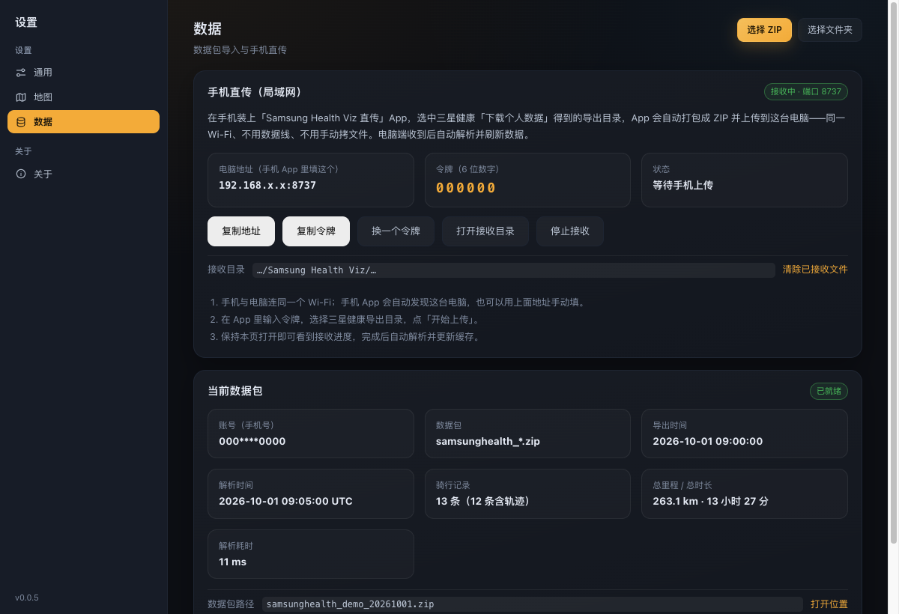

# Samsung Health Viz · 三星健康可视化

把三星健康（Samsung Health）导出的数据包变成本地可视化桌面应用：
导入导出的 ZIP 或文件夹，自动解析骑行记录与 GPS 轨迹，生成生涯统计、骑行列表和地图路线。


> 截图使用虚构的演示数据，不含真实个人信息。

## 功能

- **生涯总览**：总里程 / 时长 / 爬升 / 消耗、年度统计、个人最佳、骑行日历、全部路线地图（按城市聚类筛选）
- **骑行记录**：按年份 / 距离 / 时长排序，显示天气、心率与轨迹
- **单次详情**：轨迹按速度着色，速度 / 心率 / 海拔 / 恢复心率曲线，每公里分段配速
- **地图**：高德暗色 / 标准 / 卫星、Stadia Maps 系列、Esri 卫星、OSM、无底图；支持底图淡化与全屏查看
- **手机直传**：同一 Wi-Fi 下，手机把导出目录直接打包传到电脑（Android App 在 [`android/`](android/README.md)）
- **多语言 / 主题**：中文 / English，深色 / 浅色 / 跟随系统，功能集中在独立设置窗口

## 安装

从 [Releases](https://github.com/kongchenhui/samsung-health-viz/releases) 下载：

| 平台 | 产物 |
|---|---|
| macOS（Apple Silicon） | `.dmg` 安装包 / `.pkg` / `.zip` |
| Windows x64 | `.exe` 安装包 / `.zip` 便携版 |
| Linux x64 | `.AppImage` / `.deb` |
| Android | 手机直传 App `.apk` |

应用未签名：macOS 首次打开需右键 →「打开」；Windows 提示时点「更多信息 → 仍要运行」。

## 使用

1. 手机三星健康 App → 设置 → 下载个人数据，得到 `samsunghealth_<账号>_<时间>.zip`；
2. 打开应用，选择该 ZIP（或解压后的文件夹），解析完成后进入「生涯」页；
3. 「设置 → 数据」可随时更换数据包或清除缓存。

### 手机直传（可选）

不想每次插数据线时：电脑端在「设置 → 数据 → 手机直传」开启接收，手机装直传 App（同一 Wi-Fi）后输入令牌上传，
电脑端收到后自动解析并刷新。构建与安装见 [android/README.md](android/README.md)。



## 地图底图

默认高德暗色。Stadia Maps 系列需要 API Key（在「设置 → 地图」填写，只保存在本机）；
免费 Key 即可使用除 Alidade Satellite 外的大部分样式。各底图版权已在右下角按要求展示。

## 隐私

- 数据包只在本机解析，**不会上传**；解析结果缓存在本机应用数据目录；
- 只读解析，不修改原始数据包；
- 手机直传只在局域网内进行，6 位令牌校验，不经过三星账号凭据。

## 开发

```bash
pnpm install
pnpm dev        # 开发：Vite + Electron（渲染层热更新）
pnpm build      # 构建渲染层
pnpm start      # 以构建产物启动
```

目录结构、打包发布、自动更新、数据解析规则、多语言与城市数据等维护者文档见
[docs/development.md](docs/development.md)。
